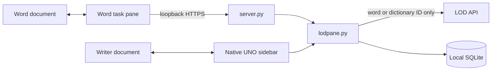

# Architecture

LOD pane has one shared dictionary/storage core and two host interfaces.

## Runtime

| Component | Responsibility |
| --- | --- |
| `lodpane.py` | LOD requests and normalization, input validation, preferences, vocabulary and SQLite transactions |
| `server.py` | Word's loopback HTTPS server and JSON API, bound to `127.0.0.1:43127` |
| `word/` | HTML/CSS/Office.js pane, selection tracking, drafts and explicit document replacement |
| `libreoffice/panel.py` | Native UNO factory, controls, queued lookups, selection and Writer editing |

Both hosts share the per-user SQLite database when they use the same data
folder. `LOD_PANE_DATA_DIR` isolates tests. The core and server use Python's
standard library; the frozen Word installer adds cryptography for certificates.

## Contracts

- Only lookup words and dictionary IDs go to LOD. Notes, excerpts and saved
  vocabulary stay local. Word passes these through its local companion.
- The HTTP server validates Host, Origin and the API header, serves an asset
  allowlist, and does not log document or vocabulary contents.
- Vocabulary records are keyed by entry and sense. Updates and deletes compare
  `baseUpdated` inside a transaction to reject stale writes.
- Background lookup results have generation checks so old replies cannot replace
  newer selections. UNO results return through the host's UI callback queue.
- Excerpts are optional and limited to 1,000 characters around the selected word.
- Replacement requires a preview and confirmation. Both hosts verify the captured
  text and location, reject read-only documents, and use native Undo. Word also
  releases tracked ranges. Lookup and saving do not edit the document.
- Both host interfaces own their unsaved drafts and presentation. Parsing,
  validation and persistence belong to the shared core.

## Installation and releases

`tools/build.py` creates the OXT, Word manifest, source setup ZIPs and checksums.
LibreOffice calls the core directly and needs no companion server.
`tools/native_libreoffice.py` opens the bundled OXT in the installed host's real
Extension Manager; users confirm Add and restart. Extension removal stays in
LibreOffice.

`tools/native_word.py` manages the frozen companion. It provisions per-user
localhost certificates, discards the CA private key, requests OS trust, registers
the Word manifest and configures login startup. A macOS LaunchAgent or Windows
Run entry invokes the supervisor in `tools/install_word.py`. A lock prevents
duplicate supervisors; a stop request terminates only the supervisor's owned
child. Uninstall preserves vocabulary.

On macOS, `tools/native/word_folder_access.swift` requests access to Word's
Documents/wef folder through NSOpenPanel. During that transaction, it handles
only `wef/lod-pane.xml` snapshot/write/remove/restore commands over local pipes.
It guards rollback against concurrent edits. Python and background server
processes do not access Word's protected container or request Full Disk Access.

Native packages bundle their runtime. The source ZIP installer remains a manual
alternative requiring Python and Node.js. `SETUP.md` documents installation,
paths, certificate approval and troubleshooting.

`.github/workflows/release.yml` follows successful main CI, builds the exact
tested commit on macOS and Windows, and publishes immutable preview assets.
`tools/native/build_info.py` stamps the source SHA; `package_macos.py` validates
fixed-path atomic app replacement. Logs identify the build, executable and setup
phase. Packages remain unsigned and macOS packages are not notarized.

## Verification limits

Core/HTTP/package tests, fixture-backed Word browser tests, installer tests,
compiled Swift checks and frozen HTTPS smoke tests run locally or in CI. The
native Writer probe covers controls, selection, saving, replacement/Undo and
layout in a disposable profile, including action refreshes in the 272-pixel
viewport left by a narrow deck's scrollbar. On 2026-10-25, installed Writer
0.8.0 lookup, meaning/example changes, Favorites saving and reopening, and
light/dark rendering were checked on macOS. README media records that session.

Real Word installation and editing acceptance remain pending on the user's
other Mac. The reported protected-folder error prompted the scoped helper and
versioned upgrade diagnostics; successful real-host confirmation is still
required. Keyboard, screen-reader and distribution compatibility checks also
remain open. Test passes do not establish host acceptance.
