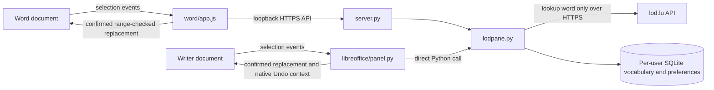

# LOD pane Architecture

## Purpose

Look up selected Luxembourgish words, save vocabulary, and explicitly replace a selected word with its LOD headword inside Word and LibreOffice Writer. The reading-first notebook retains concept 06's palette and headword typography, with optional notes and context revealed on request.

## Scope and Assumptions

- Verified code scope on 2026-10-18. The source currently implements a loopback Word companion and a native LibreOffice sidebar. AgDR-0004 describes a hosted/browser-storage direction, but that direction is not implemented in `word/app.js`, `server.py`, or the generated manifest. No hosted deployment is included here.
- Word calls the companion API for lookup, vocabulary and preferences. LibreOffice calls the core directly through bundled Python. Both use the same per-user SQLite store when running as the same OS user and data directory.
- Live LOD requests, core tests, HTTP tests, browser tests with an Office stub, Microsoft manifest validation, and a real headless LibreOffice probe have run.
- Two native LibreOffice failures were reproduced and fixed: standalone UNO control models reject the dialog-only `Name` property, and the host's layouter can call `getHeightForWidth` while a control model is transiently unavailable. The probe covers factory creation, controls, selection listener, queued lookup, events, vocabulary, host-theme adoption, capped-width layout at two deck sizes, and disposal.
- Writer v0.7.0 uses native buttons and XActionListener for every action, native toggle buttons for choices, and native Edit fields. There are no custom mouse filters, hyperlinks or ListBox/ItemListener choices. Buttons own click and Enter/Space activation; XKeyListener only adds search Enter and settings Escape behavior. A TabController orders visible enabled controls. This replaces v0.6.1's custom mouse handlers, which failed in the installed sidebar despite passing isolated-dialog tests. The current probe verifies native button/toggle activation and existing workflows in a separate dialog. That is not proof of physical mouse input in the installed sidebar. Basic assertion failures explicitly stop and write FAIL. The probe alone does not verify real-sidebar appearance or assistive-technology behavior; the limited installed-sidebar check is recorded below. See [AgDR-0008](docs/agdr/AgDR-0008-native-writer-actions.md).
- On 2026-10-24, the OXT installed through Extension Manager in a disposable macOS profile. After restart, the actual Writer sidebar followed a selected `Wieder`, displayed live LOD results, changed meanings, saved to Favorites, and reopened the saved list through native control clicks. Screenshots and a step animation are in `docs/media/`. This is a limited smoke check; the full acceptance checklist and assistive-technology checks remain open.
- Real Word (web and desktop) is unavailable in this environment and remains manually unverified. Sandboxed distributions, mobile hosts, store publishing, and centralized deployment are not verified.

## System Overview

The runtime has one shared Python module and two host UIs. `lodpane.py` owns dictionary normalization, validation, preferences, and vocabulary persistence. `libreoffice/panel.py` calls it directly. `word/app.js` calls the same functions through the loopback API in `server.py`.

Both hosts access one per-user SQLite database. There is no remote application backend or sync layer. `prototypes.html` and `learner-prototypes.html` remain independent design artifacts, not runtime dependencies.

## Architecture Diagram

## Runtime Entry Points

- `python3 tools/build.py` builds `dist/lod-pane.oxt`, `dist/word-manifest.xml`, the Word setup ZIPs for macOS and Windows, checksums, and both icon sizes.
- Word testers upload the manifest through **Upload My Add-in** or a catalog. Its current source location is `https://localhost:43127/word.html`.
- `python3 server.py` serves the Word pane over loopback HTTPS on 127.0.0.1:43127 with a trusted development certificate. The current Word build requires this companion. Publishing a hosted build remains separate work.
- `python3 tools/install_word.py` installs the per-user Word companion and development manifest, invokes Microsoft's certificate trust utility, and configures login startup. Its `start`, `stop`, `status`, and `uninstall` actions manage that installation. ZIPs include platform-specific command wrappers. Python 3.9+ and Node.js 22 LTS remain installation prerequisites.
- `tools/native_word.py` is the frozen application's entry point. Native EXE/PKG packages include Python and use bundled cryptography for local certificates, so end users need neither Python nor Node.js. First launch completes per-user trust, manifest registration and startup. Native packages target Windows x64 and Apple Silicon macOS; unsigned previews and real Word behavior retain the limits described in `SETUP.md`.
- `libreoffice/panel.py` registers `org.lodpane.PanelFactory`. LibreOffice creates the panel through its sidebar configuration packaged by the build tool.
- `python3 tests/test_runtime.py` checks core and HTTP/package behavior. `tests/libreoffice-runtime.py` exercises the real factory, controls, listeners, save flow, and layout in a disposable LibreOffice profile. `tests/word-runtime.cjs` runs a fixture-backed HTTPS app with an Office boundary stub.

## Architectural Layers

1. **Shared core.** `lodpane.py` calls the fixed LOD endpoints, preserves separate dictionary meanings, validates selected words and save requests, and handles SQLite transactions. It uses only Python standard-library modules.
2. **Word transport.** `server.py` serves an explicit asset allowlist and a small JSON API over loopback HTTPS. Host/Origin validation and a non-simple API header protect the local boundary without CORS. Vocabulary requests, including notes and opted-in excerpts, reach the local core and SQLite. Only dictionary words reach LOD. The server does not serve arbitrary files or log word/note content.
3. **Word UI.** `word/index.html`, `word/style.css`, and `word/app.js` implement the reading-first notebook. Settings, notes and excerpts use native HTML details. Draft disclosures remain per entry/sense; saved notes and excerpts reveal automatically. The save footer stays pinned while entries scroll. Saved vocabulary has text filtering and JSON export. Office.js reads the selection and, only after opt-in, a nearby paragraph. A long paragraph becomes a 1,000-character window around the selected word, not a prefix that can omit it. Entry text uses DOM textContent, not dictionary-generated HTML. The manifest requests ReadWriteDocument for an explicit replacement preview. A tracked range records the previewed text/location; comparison with the current selection precedes insertText with Replace. The range is untracked on closing, Home, a changed result or completed replacement. Preview text stays in the webview, not the API. Home clears the active view, cancels outstanding lookup/library work and preserves note drafts.
4. **LibreOffice UI.** `libreoffice/panel.py` implements the required UNO factory, UI element, and panel interfaces. Native controls occupy one centered column capped at 380 units. Native peers measure wrapped text at the actual width with `calcAdjustedSize`. Language and destination choices use native toggle state and a checkmark when selected. The Change meaning action reveals translated single-click rows with pagination, without a five-sense limit. The example label and body are separate measured controls; changing meaning updates translation, grammar and example together. Examples remain Luxembourgish regardless of translation language. Candidate and vocabulary buttons paginate; vocabulary also filters by word, translation, note or destination. Notes reveal on request or when nonempty; opted-in context uses the same word-anchored excerpt logic. The panel adopts the host theme on first use, then remembers an override. `getHeightForWidth` reports natural content height; Writer's host scrolls the panel, including Save. Selection identity includes the text range, so another occurrence of the same word refreshes the paragraph without repeating an unnecessary lookup. Replacement captures a Writer text cursor and validates current text and region boundaries before inserting the headword inside a named UndoManager context. Read-only documents are rejected. Selection callbacks are suppressed during this explicit edit; previews are invalidated on use, new results, Home, hiding and disposal. Home is a persistent native button that cancels work and retains in-memory drafts. Background work returns through the UNO callback queue and generation checks reject stale replies, including after opening Saved or Home. Model access is guarded and disposal is idempotent.
5. **Packaging and installation.** `tools/build.py` bundles the exact core source into the OXT's `pythonpath` folder and generates the minimal add-in-only Word manifest. Word ZIPs include the server, core, web assets, setup instructions, and `tools/install_word.py`. Setup copies these into a per-user `word-companion` folder, outside the vocabulary database. Microsoft's pinned npm utilities perform explicit certificate trust and development registration. A macOS LaunchAgent or Windows current-user Run key invokes a lock-protected supervisor at sign-in. The supervisor owns one server child and uses a local stop request rather than PID-based termination. Management actions serialize start/stop/setup; startup checks use validated HTTPS. Uninstall removes registration/startup while preserving vocabulary and shared certificates. Logs and the inactive manager remain for inspection. See [AgDR-0010](docs/agdr/AgDR-0010-word-background-installation.md).
6. **Native packaging and releases.** `.github/workflows/release.yml` runs after successful CI for pushes to `main`, including merges. It checks out the exact tested SHA, builds and checks the installer packages on macOS and Windows runners, and publishes commit-specific preview assets with checksums. Existing release assets are not overwritten. PyInstaller freezes `tools/native_word.py`, the core, server and web assets. Inno Setup produces a per-user Windows EXE installer; `pkgbuild` packages the macOS app into a PKG. Native certificate provisioning creates a per-user CA and localhost leaf, discards the CA private key, and requests user trust through OS tools. Manifest registration uses the macOS WEF folder or Windows current-user WEF Developer value. Native startup reuses the supervisor and lock logic from `tools/install_word.py`; frozen server children invoke the bundled executable's `serve` action. Native uninstall removes only its manifest registration, startup and CA trust, retaining local data. The standard-library runtime core remains unchanged; cryptography is an extra dependency of the frozen native setup only. Installer tests mock host registration; frozen smoke tests exercise validated loopback TLS with temporary certificates. Real Word remains unverified. See [AgDR-0011](docs/agdr/AgDR-0011-native-word-installers.md).

## External Integrations

- **LOD:** `https://lod.lu/api/lb/search?lang=lb&query=…` and `/entry/{id}`. Only the normalized lookup word or dictionary ID is transmitted. LOD failures become recoverable UI messages.
- **Word:** Office.js loaded from Microsoft's official CDN. `DocumentSelectionChanged`, `getSelectedDataAsync`, WordApi paragraph access, tracked ranges, compareLocationWith and explicit insertText replacement. The manifest requires WordApi 1.3 and `ReadWriteDocument`, version 1.1.0.0. Real Word editing/Undo remains unverified.
- **LibreOffice:** UNO sidebar factory, native controls, selection listener, asynchronous UI callback, file picker, and system browser opening.
- **Vocabulary storage:** standard-library SQLite in both paths. The OS user data folder is computed by `data_directory`; `LOD_PANE_DATA_DIR` supports isolated tests. The settings table holds theme and translation language. Word accesses it through the companion; Writer accesses it directly.

## Core Data Flow (Current)

1. A host selection event reads a single word locally. Empty selections caused by moving focus into the pane do not clear the entry or its draft. Lookup is debounced; superseded replies cannot replace a newer result.
2. The core validates the word before contacting LOD. A literal headword takes priority over an unrelated entry's inflection match. Multiple exact homonyms require an explicit choice.
3. The full entry is normalized into separate senses, each with translations, available grammar, and an example. A small process-local LRU avoids fetching the same entry repeatedly; there is no custom cache service.
4. Drafts are per entry and sense in the open host UI. Theme, language, and sense changes do not overwrite another draft.
5. Optional nearby-text capture reads a paragraph excerpt locally, capped at 1,000 characters. It is not sent to LOD. Explicit Word saves send it to the local companion.
6. Explicit save validates the payload and commits an entry/sense record, note, destination, and opted-in context to SQLite. The key is `entryId#senseId`, so different meanings do not overwrite one another. Each update and delete compares the record's `updated` value inside an immediate transaction; a stale Word or Writer pane gets a reload message instead of silently overwriting newer changes. Disclosure flags are UI-only and are excluded from save payloads.
7. Saved vocabulary is available offline through Writer or the running local companion. An exact saved headword can be shown if a live lookup fails. New dictionary lookups and loading Microsoft's Office.js need internet. Both hosts share SQLite when using the same data directory, but open panes refresh their lists only on explicit reload of Saved.
8. Explicit replacement captures one selected word when its preview opens. It preserves surrounding whitespace and uses the dictionary headword, without inferring translations or inflection. Changed text/location, including another occurrence of identical text, and read-only documents are rejected. The edit goes directly to the host, uses native Undo, and never calls the vocabulary API. Home cancels transient work, releases previews and clears results without deleting drafts or saved words.
9. JSON export provides a portable snapshot in both hosts. There is no import UI. Copying the closed LibreOffice database is its complete local backup route.

## Module Ownership Boundaries

- The core owns dictionary behavior; neither host duplicates the LOD parser. It runs in the loopback companion for Word and inside LibreOffice's Python for the sidebar.
- `server.py` is Word's current transport and is not a dependency of the LibreOffice extension.
- Each UI owns presentation, selection handling, captured replacement ranges, explicit document editing and unsaved drafts. The shared core owns the vocabulary store. No UI abstraction framework bridges HTML and native UNO controls.
- LibreOffice SQLite serializes local writes. There is no shared store, sync layer, or migration framework for this first schema.
- Prototype localStorage data is separate and is never silently imported.
- Exported data, notes, and document excerpts remain local unless the user shares the files.
- Word cannot work without the companion. LibreOffice cannot work without its Python/UNO support. Neither installation is claimed to be certified merely because a manifest or archive validates.

## Architecture Change Protocol

Preserve the one-core/two-host boundary. Add a dependency or background service only when a verified requirement needs it. Record non-trivial changes in `docs/agdr/` and update this document alongside changes to host connections or storage. Use `SETUP.md` for user-facing setup, not implementation notes hidden in source files.

## Future Clarifications

- Complete the real Word acceptance checklist, including companion availability, keyboard navigation, resize/scroll behavior, and supported OS versions. Complete Writer keyboard, resize, and assistive-technology checks in the real sidebar.
- Confirm a deployment/storage design, permanent origin, availability target, and LOD content terms before publishing a hosted manifest. The project is not an official LOD product. AgDR-0004's browser-storage direction still needs implementation and migration decisions.
- Organization deployment, backup import, review scheduling, browser-vault interchange, and cloud sync are deliberately not implemented.
