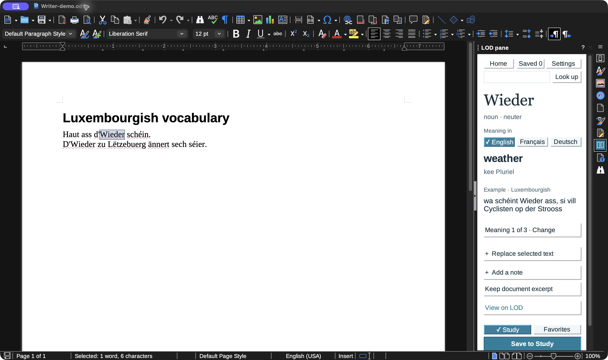
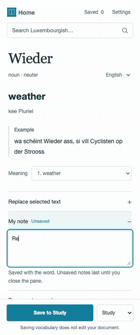
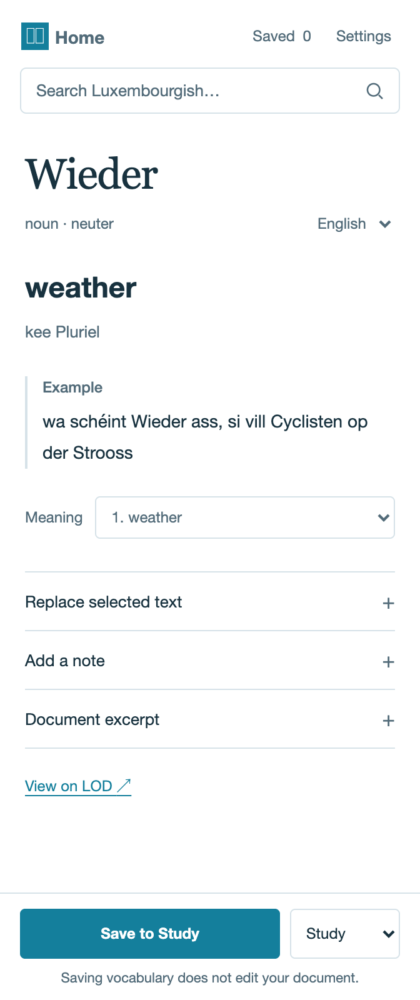
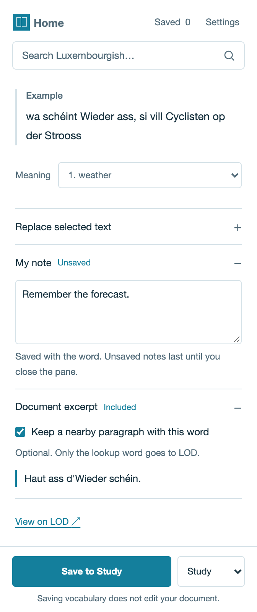
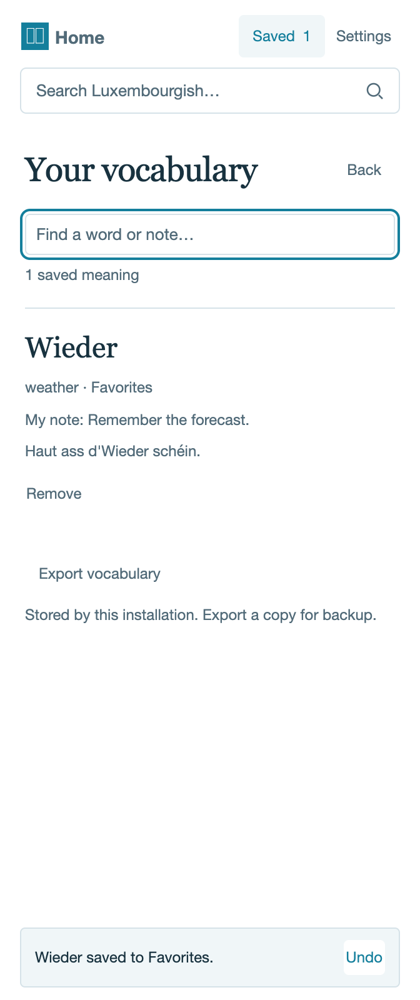
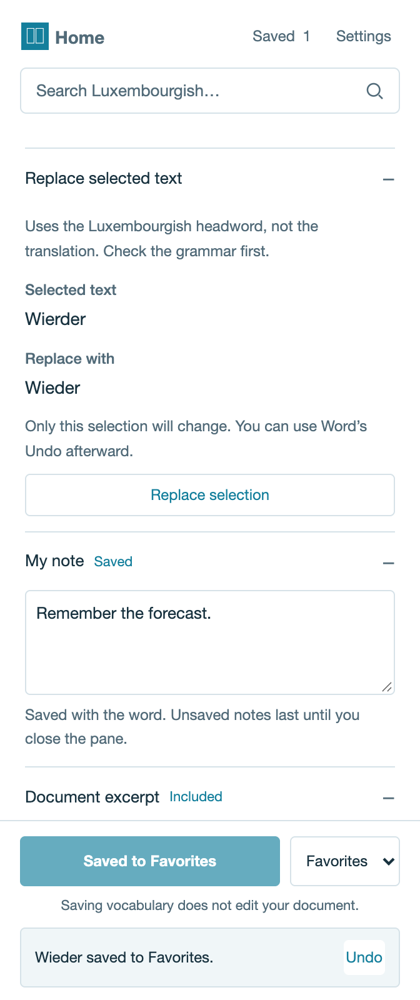
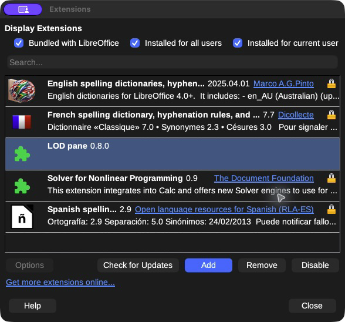

# LOD pane

LOD pane is a reading-first dictionary for Luxembourgish. Select a word in
Microsoft Word or LibreOffice Writer, read its meaning and example, and save it
to a local vocabulary notebook.

This is an early implementation. Lookup, meaning changes, and vocabulary saving
have been checked in the installed LibreOffice sidebar on macOS. The full
acceptance checklist and real Word testing remain open. This is not an official
LOD product.

## Demo

### LibreOffice Writer

[](docs/media/libreoffice-demo.webm)

This step animation uses screenshots from the installed native sidebar with live
LOD results and an isolated vocabulary database.



### Word task-pane preview

[](docs/media/word-demo.webm)

The Word captures use the real task-pane code with a fixture dictionary and an
Office.js boundary stub. They are product previews, not evidence of real Word
acceptance.

## How it works

### Look up a selected word

Select a Luxembourgish word in the document. The pane opens its LOD meaning,
grammar, example, and separate senses when the entry has more than one.



### Add a note and document excerpt

Notes stay hidden until requested or saved. A document excerpt is optional,
limited to 1,000 characters, and kept around the selected word.



### Save and revisit vocabulary

Save a meaning to Study or Favorites, then search, edit, remove, or export the
local vocabulary.



### Preview a replacement

Replacement uses the LOD headword, not a translation. Nothing changes until the
preview is confirmed, and the host's normal Undo remains available.



## What it does

- Looks up Luxembourgish words through the LOD API.
- Keeps distinct meanings separate and shows English, French, or German translations.
- Saves notes, an optional nearby paragraph, and a Study or Favorites destination in local SQLite.
- Replaces a selected word with its LOD headword, but only after a preview and confirmation.
- Works without an account, analytics, or cloud sync.

Only the lookup word or dictionary ID goes to LOD. Notes and document excerpts
stay in the local database.

## Quick start

[Download a release](https://github.com/Mohammed-Ashour/lod-pane/releases).
Preview releases are published after CI passes for each push or merge to `main`.
This repository is private, so downloads require repository access.

LibreOffice 7.4 or later must include Python UNO support. Source builds and the
optional script installers require Python 3.9 or later.

### LibreOffice Writer

Install LibreOffice, then download `lod-pane-libreoffice-windows-x64.exe` or
`lod-pane-libreoffice-macos-arm64.pkg`. Run the installer. On macOS, open
**LOD-pane-LibreOffice** from Applications afterward. The helper opens the
bundled extension in LibreOffice; confirm **Add** and choose **Only for me** if
asked. Fully quit and reopen LibreOffice, then open **View > Sidebar > LOD pane**.
No server, certificate setup, Python, or Node.js installation is needed.

You can also download `lod-pane.oxt` and add it through **Tools > Extensions**.
To build from source instead, run `python3 tools/build.py`.



### Microsoft Word

Download `lod-pane-word-windows-x64.exe` for Windows or
`lod-pane-word-macos-arm64.pkg` for an Apple Silicon Mac. Close Word and run the
installer. On macOS, open **LOD-pane-Word** from Applications after installation.
Complete the one-time localhost certificate approval. No separate Python or
Node.js installation is required.
On macOS, select Word's **Documents** or **wef** folder when setup asks for
**Allow Access**, so it can register the add-in.

In the folder picker, click inside the window, press **Cmd+Shift+G**, paste
this path into the **Go to Folder** box, and press **Return**:

```text
~/Library/Containers/com.microsoft.Word/Data/Documents/
```

Select that **Documents** folder and click **Allow Access**. The `~` stands for
your home folder. For example, for a macOS account named `alex`, the full path is:

```text
/Users/alex/Library/Containers/com.microsoft.Word/Data/Documents/
```

You can also select the existing `wef` subfolder directly:

```text
~/Library/Containers/com.microsoft.Word/Data/Documents/wef/
```

Word uses `wef` to discover locally registered add-ins. Setup creates it if
needed and writes `lod-pane.xml` there. If Word's internal **Documents** folder
does not exist, open Word once, quit it, and retry setup.

Windows setup handles add-in registration automatically. To inspect the installed
files, press **Win+E**, paste one of these paths into File Explorer's address
bar, and press **Enter**:

| Windows path | Contents |
| --- | --- |
| `%LOCALAPPDATA%\Programs\LOD pane Word\` | Installed app, including `LOD-pane-Word.exe` |
| `%LOCALAPPDATA%\LOD pane\word-companion\` | Setup state, `word-manifest.xml`, certificates and `companion.log` |
| `%LOCALAPPDATA%\LOD pane\` | Local vocabulary and preferences |

For example, `%LOCALAPPDATA%` usually expands to
`C:\Users\alex\AppData\Local` for an account named `alex`. The macOS folder
picker steps above apply only to macOS; Windows does not ask you to select a
`wef` folder.

Setup registers the development manifest and runs the local HTTPS companion in
the background, including at future sign-ins. Restart Word and open
**Home > Add-ins > LOD pane**. Open the installed app to start, stop, or uninstall
the integration. Windows also has an entry in Installed apps.

These preview installers are unsigned. Development sideloading must be allowed.
If macOS blocks the PKG, follow the [per-download approval steps](SETUP.md#macos-blocks-the-unsigned-pkg).
The source ZIPs remain available for manual setup. See [SETUP.md](SETUP.md) for
paths, platform limits, and troubleshooting.

The manifest requests `ReadWriteDocument` because replacement is an explicit
feature. Lookup, saving vocabulary, and Home do not edit the document.

## Project layout

```text
lodpane.py             LOD parsing, validation, and SQLite storage
server.py              loopback HTTPS API for the Word pane
word/                  Word task pane: HTML, CSS, Office.js
libreoffice/panel.py   native LibreOffice Writer sidebar
tools/                 package build and host setup helpers
tests/                 fixture-backed runtime and package checks
```

The shared dictionary/server core uses only the Python standard library. Native
installers bundle cryptography for localhost certificates. The Word pane is
plain HTML, CSS, and JavaScript.

## Checks

The core suite needs only Python and does not call the live LOD service:

```sh
python3 tests/test_runtime.py
python3 -m py_compile lodpane.py server.py tools/*.py tests/*.py
node --check word/app.js
```

Optional host checks:

```sh
python3 tests/libreoffice-runtime.py [--soffice /path/to/soffice]
```

This runs the real UNO panel in a disposable LibreOffice profile. It requires a
local LibreOffice installation.

The Playwright checks require Google Chrome, OpenSSL, and Playwright:

```sh
npm install --prefix /tmp/lod-pane-browser-tests playwright
PLAYWRIGHT_MODULE=/tmp/lod-pane-browser-tests/node_modules/playwright \
  node tests/word-runtime.cjs
```

They use port `43127`, replace LOD with fixtures, and stub the Office
JavaScript boundary. They do not prove that the add-in works in real Word.

## Documentation

- [Setup and host installation](SETUP.md)
- [Architecture](ARCHITECTURE.md)
